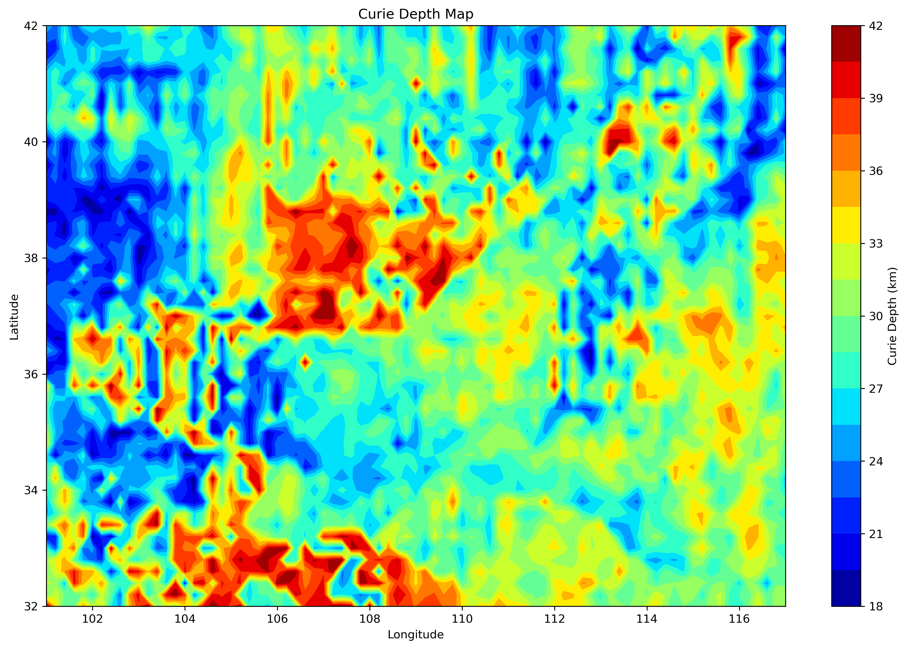
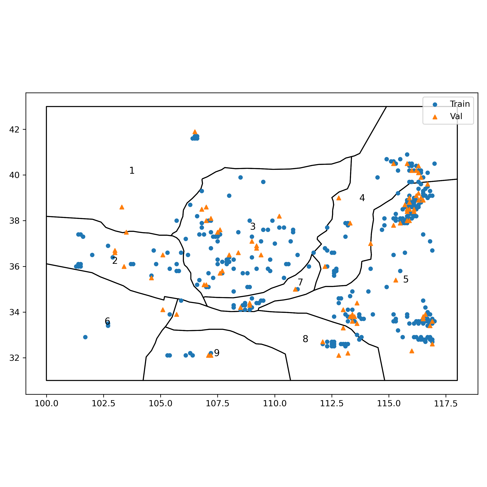
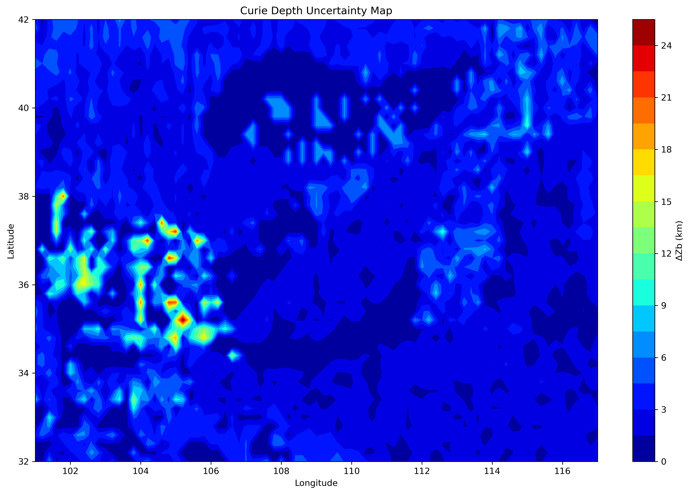
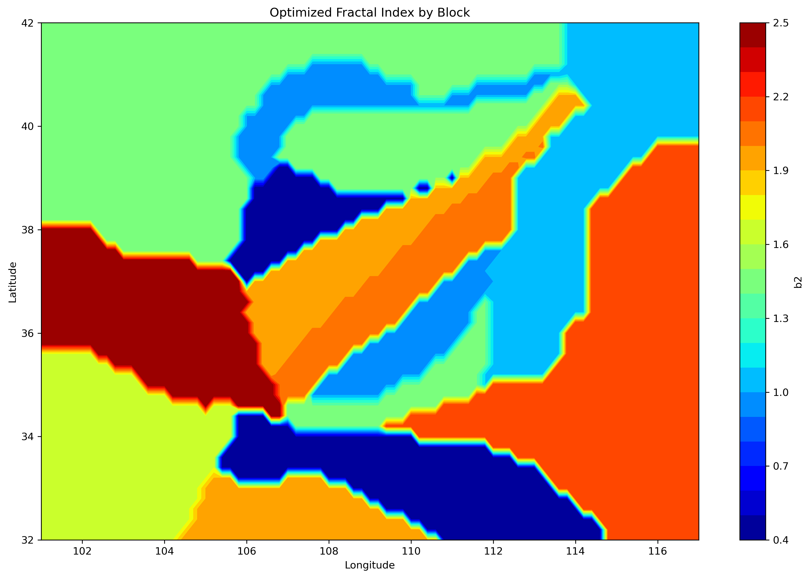
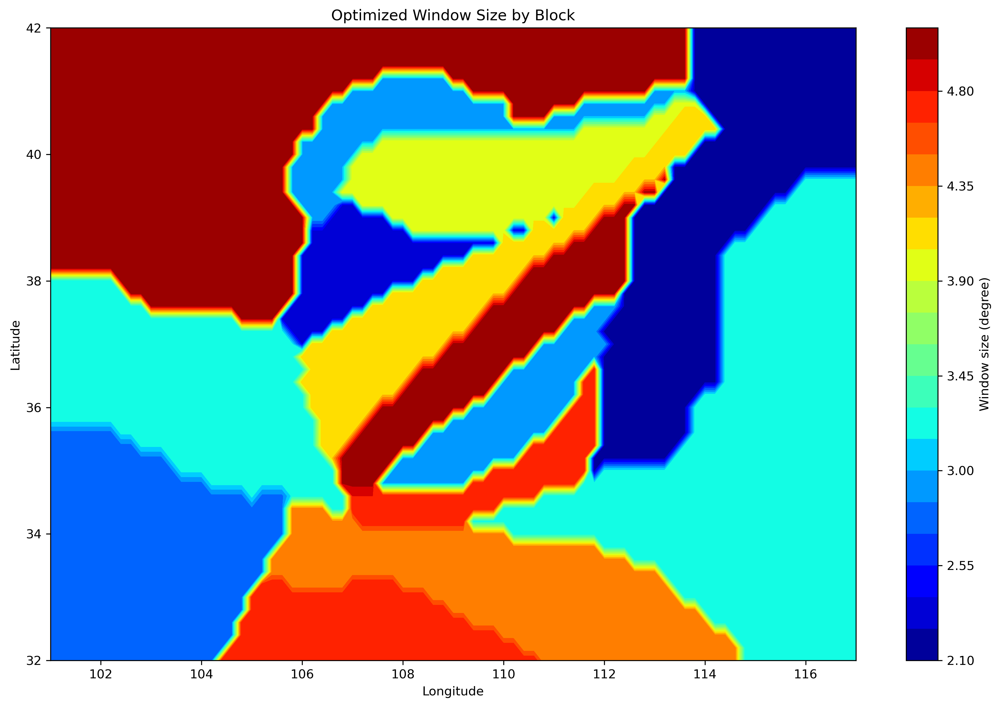
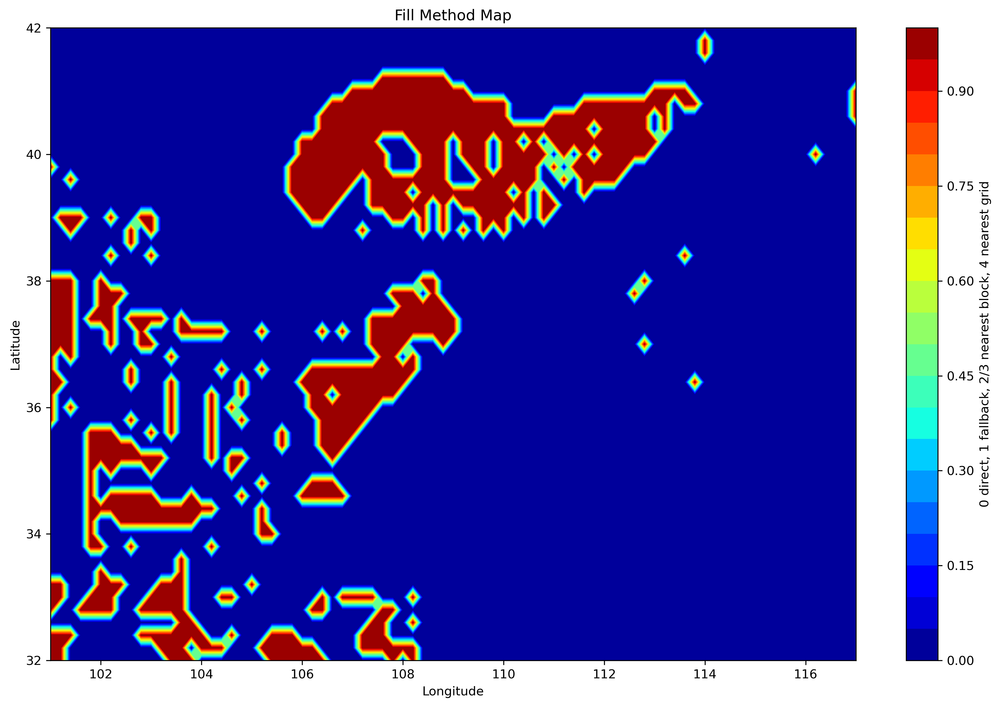
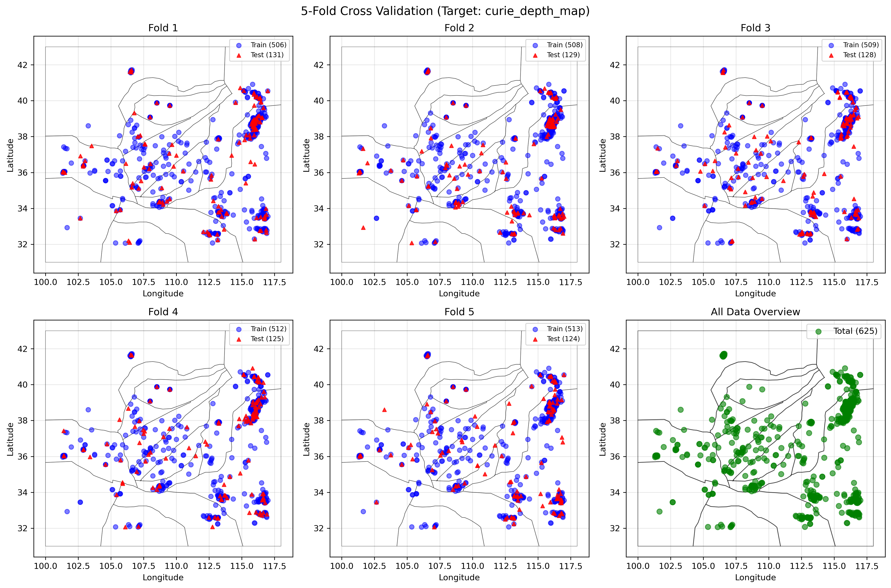
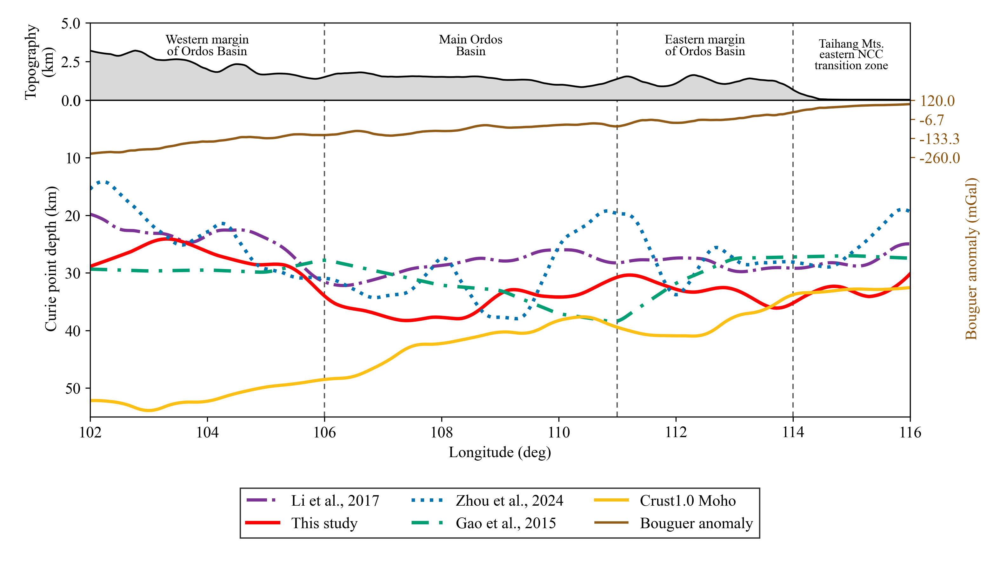

# Adaptive Inversion of the Curie Isothermal Surface — Ordos Basin and Surrounding Regions

Source code for the block-wise, multi-constraint and Bayesian-optimized inversion of the
**Curie isothermal surface (CIS)** described in:

> *Adaptive Inversion of the Curie Isothermal Surface in the Ordos Basin and Surrounding
> Regions Based on Multiple Constraints and Bayesian Optimization*,
> Q. Fan, G. Gao, Z. Wang, C. Bai, L. Wen

The de-fractal spectral method is made adaptive: instead of selecting the fractal index,
the moving-window size and the spectral fitting bands by hand, these four parameters are
searched jointly with a **Tree-structured Parzen Estimator (TPE)** inside each tectonic
block, under an objective function that combines a point-fitting term, a spatial-distribution
constraint and a valid-point coverage penalty. The three terms are normalized so that they
are dimensionless and of comparable magnitude, which means that the objective contains no
weighting coefficients.



*Curie isothermal surface obtained for the Ordos Basin and surrounding regions. The basin
interior is the deepest part of the study area (up to about 42 km in the western and northern
parts), whereas the surrounding tectonic belts — the northeastern Tibetan Plateau, the Qilian
Fold System, the Qinling Orogen and the Taihang Mountains–Shanxi Rift — are markedly shallower
(about 20–30 km).*

---

## Table of contents

- [Example results](#example-results)
- [Study area and input data](#study-area-and-input-data)
- [Method](#method)
- [Output maps](#output-maps)
- [Cross-validation](#cross-validation)
- [Comparison with previous models](#comparison-with-previous-models)
- [Repository layout](#repository-layout)
- [Installation](#installation)
- [Usage](#usage)
- [Output files](#output-files)
- [Citation](#citation)
- [Data sources](#data-sources)

---

## Example results

The numbers below come from the example run shipped with this repository
(`data/` + `blocks/`, 100 TPE trials per block, 0.2° output grid). The full report is in
[`example_output/RESULTS.txt`](example_output/RESULTS.txt).

**Fit at the 180 reference points**

| Quantity | Value |
| --- | --- |
| RMSE | **6.985 km** |
| MAE | **5.289 km** |
| Bias (predicted − reference) | −2.614 km |
| Pearson *r* | 0.595 |
| Reference depth range | 15.0 – 45.0 km |
| Predicted depth range | 18.7 – 41.9 km |

**Uncertainty**, computed after the optimization from the standard errors of the two fitted
spectral slopes and *not* used inside the objective function:

| Quantity | Value |
| --- | --- |
| Median ΔZb | **1.682 km** |
| ΔZb ≤ 5 km | 166 / 180 points |
| ΔZb ≤ 10 km | 179 / 180 points |

The misfit is dominated by a small number of isolated reference points; the median
uncertainty is an order of magnitude smaller than the depth range of the model, and the
spatial cross-validation carried out in the paper shows that the spectral parameters
optimized inside one subregion transfer to only about **43 %** of the reference points of
the whole study area, which is why the model is presented as a *regional* rather than a
locally resolved description of the Curie surface.

**Optimal spectral parameters per block** (full table in
[`example_output/block_parameters.txt`](example_output/block_parameters.txt)):

| Block | *b2* | Window (°) | Zt band (km⁻¹) | Z0 band (km⁻¹) | RMSE (km) | Reference points |
| --- | --- | --- | --- | --- | --- | --- |
| 1 | 1.4 | 5.0 | 0.04186 – 0.08605 | 0.01747 – 0.02987 | 1.043 | 6 |
| 2 | 1.0 | 3.0 | default | default | — | 0 |
| 3 | 1.5 | 4.0 | 0.04279 – 0.06175 | 0.01966 – 0.02425 | 0.273 | 1 |
| 4 | 0.4 | 2.4 | 0.06120 – 0.08766 | 0.00582 – 0.04995 | 8.148 | 13 |
| 5 | 1.9 | 4.2 | 0.04955 – 0.07165 | 0.00434 – 0.02092 | 3.989 | 9 |
| 6 | 2.1 | 5.0 | 0.04487 – 0.07151 | 0.01239 – 0.03159 | 3.135 | 11 |
| 7 | 1.0 | 3.0 | 0.06386 – 0.08435 | 0.01323 – 0.04707 | 2.956 | 9 |
| 8 | 1.4 | 4.8 | 0.05804 – 0.07810 | 0.01041 – 0.05456 | 5.271 | 17 |
| 9 | 1.1 | 2.2 | 0.04631 – 0.08488 | 0.01705 – 0.03361 | 5.682 | 14 |
| 10 | 2.5 | 3.2 | 0.03577 – 0.06545 | 0.01874 – 0.02715 | 4.816 | 7 |
| 11 | 1.7 | 2.8 | 0.02700 – 0.06111 | 0.00410 – 0.02222 | 4.685 | 3 |
| 12 | 0.5 | 4.4 | 0.06378 – 0.07252 | 0.01683 – 0.03959 | 6.087 | 6 |
| 13 | 2.2 | 3.2 | 0.04746 – 0.08895 | 0.00341 – 0.03395 | 4.780 | 40 |
| 14 | 1.9 | 4.8 | 0.03128 – 0.07137 | 0.00460 – 0.02399 | 3.143 | 1 |

> Block 2 contains no reference point, so the optimizer falls back to the default spectral
> parameters there (`status = no_true_points_default`). The values quoted for its RMSE are
> placeholders and do not represent a fit quality.

The optimal parameters differ substantially between blocks (*b2* from 0.4 to 2.5, window
size from 2.2° to 5.0°), which is the quantitative justification for inverting the study
area block by block instead of applying one parameter set everywhere.

---

## Study area and input data

The study area covers approximately **101–117° E, 32–42° N** and includes the Ordos Basin
with the Yinshan orogenic belt to the north, the Qinling orogen to the south, the Alxa Block
and the Qilian Fold System to the west and southwest, and the Taihang Mountains–Shanxi Rift
to the east.

The block division follows the major fault zones and basement boundaries of the region. The
14 blocks and the reference points are shown below; the polygons are digitized with
`utilities/digitize_faults.py`, whose vertices snap to the mapped fault traces.



| File | Columns | Description |
| --- | --- | --- |
| `data/ordos_magnetic_anomaly.txt` | `lon lat magnetic_anomaly` | Crustal magnetic anomaly grid (281 × 401 nodes, 0.05°) derived from EMAG2v3 |
| `data/curie_depth_reference_points.txt` | `lon lat Zb_km` | 180 reference Curie depths converted from measured heat flow |
| `data/bouguer_gravity_wgm2012.txt` | `lon lat gravity_mGal` | Complete Bouguer anomaly of the WGM2012 model (2′, 95–124° E, 30–44° N), used for the comparison with the crustal structure |
| `data/fault_traces.txt` | `>` header, then `lon, lat` | Multi-line fault traces in EPSG:4326 |
| `blocks/block_<N>_fixed.txt` | `lon lat` | Closed polygon of block `N`, non-overlapping, tiling the study area |

---

## Method

### 1. De-fractal spectral analysis

For a moving window centred on each grid node, the radially averaged power spectrum of the
magnetic anomaly is computed. A fractal index correction is applied before the two
least-squares fits, and the depths follow from the slopes of `ln(power)` against the
wavenumber `k`:

```
Zt = slope over the medium-to-high wavenumber band      (top of the magnetic layer)
Z0 = slope over the low wavenumber band                 (centroid of the magnetic layer)
Zb = 2 * Z0 - Zt                                        (bottom = Curie isothermal surface)
```

The factor `2π` is applied when converting the spectral slopes to depths.

### 2. Parameters searched by Bayesian optimization

| Parameter | Meaning | Range used here |
| --- | --- | --- |
| `b2` | fractal index | 0 – 3.0, step 0.1 |
| `window_size` | moving-window size (°) | 2.0 – 5.0, step 0.2 |
| `k_cent_min`, `k_cent_max` | fitting band for `Z0` (km⁻¹) | 0.002 – 0.020, 0.020 – 0.060 |
| `k_top_min`, `k_top_max` | fitting band for `Zt` (km⁻¹) | 0.025 – 0.065, 0.060 – 0.090 |

The wavenumber ranges are expressed as real wavenumbers rather than integer indices. A
minimum band width and a minimum number of spectral points per band are enforced.

### 3. Objective function

The objective function is the sum of dimensionless terms, so that no weighting coefficients
have to be introduced:

```
L = Lp / std_ref  +  Lpair / std_ref  +  (1 - rho)  +  rmis  +  (1 - Nv / N)
```

* **`Lp` — point-fitting term**

  ```
  Lp = sqrt( (1/Nv) * sum_i ( Zb_inv,i - Zb_ref,i )^2 )
  ```

  All valid reference points enter with equal weight, so no east–west depth trend is
  imposed a priori.

* **`Lpair` — pairwise depth-difference term**

  ```
  Lpair = sqrt( sum_ij omega_ij * [ (Zb_inv,i - Zb_inv,j) - (Zb_ref,i - Zb_ref,j) ]^2
                / sum_ij omega_ij )
  ```

  with the distance weight `omega_ij = 1 / (d_ij + 0.05)`. This term constrains the spatial
  relief of the inverted depth field rather than its absolute level.

* **`1 - rho` — correlation loss**

  `rho` is the Pearson correlation coefficient between the inverted and the reference
  depths, so this term penalises a wrong overall spatial trend.

* **`rmis` — relative depth-ordering term**

  ```
  rmis = (1/Nv) * sum_ij I[ sgn(Zb_inv,i - Zb_inv,j) != sgn(Zb_ref,i - Zb_ref,j) ]
  ```

  It penalises point pairs whose relative deep/shallow order is reversed.

* **`Lm = 1 - Nv / N` — valid-point coverage penalty**

  which discourages parameter combinations that leave too few valid reference points inside
  the moving window.

The two depth-misfit terms are expressed in kilometres and are divided by `std_ref`, the
standard deviation of the reference depths of the block. Every term is therefore
dimensionless and of comparable magnitude, so that the three constraints enter the objective
with equal weight and no weighting coefficients have to be chosen.

### 4. Block-wise inversion

A single parameter set cannot represent the whole study area, because the magnetic-anomaly
spectra differ between the stable basin interior and the surrounding orogenic and rift
belts. The four spectral parameters are therefore optimized independently inside each of the
14 blocks, and the full map is computed block by block.

---

## Output maps

**Curie depth and its uncertainty** — the uncertainty is computed after the optimization
from the standard errors of the two fitted spectral slopes and is used only for the
independent assessment of the model:

| Curie depth | Uncertainty ΔZb |
| --- | --- |
|  |  |

**Parameters recovered by the optimizer** — the fractal index and the window size that were
selected for each block, together with the fill method of every node:

| Fractal index *b2* | Window size (°) | Fill method |
| --- | --- | --- |
|  |  |  |

The fill-method map documents how each node was obtained: `0` direct fit, `1` fallback
spectral band, `2/3` nearest block, `4` nearest grid node. In the example run 3490 of the
4131 nodes are direct fits, and the remaining 641 are filled with the fallback spectral band.

---

## Cross-validation

The 625 heat-flow sites of the region are split into five **spatially separated** folds, so
that neighbouring sites cannot fall on opposite sides of the split, and each candidate
Curie-depth field is converted to surface heat flow on the held-out fold.



*Five-fold spatial split of the heat-flow sites; the last panel shows all 625 sites. The
folds are built block by block so that the test points are spatially separated from the
training points.*

---

## Comparison with previous models

The recovered field can be compared with three independently published Curie-depth models of
the same region along a profile at 37° N, together with the CRUST1.0 Moho depth, the Bouguer
gravity anomaly and the topography:



*Curie depth along 37° N for this study and for the models of Li et al. (2017), Gao et al.
(2015) and Zhou et al. (2024), with the CRUST1.0 Moho depth and the Bouguer gravity anomaly.
The vertical dashed lines mark the western margin of the Ordos Basin, the eastern margin and
the Taihang Mountains.*

Within the basin interior the four models agree on a deep magnetic bottom and on the general
shape of the profile, whereas their local amplitudes differ; the additional lateral detail of
the present model reflects the block-wise optimization of the spectral parameters. Across the
western margin the published models converge towards a much shallower Curie depth, while the
present model stays close to the Moho depth.

The heat-flow agreement of the same models is summarised below; further details, including
the scatter of predicted against observed heat flow, are in
[`method_comparison/`](method_comparison/README.md).

| Heat-flow agreement | RMSE (mW m⁻²) | MAE (mW m⁻²) | Pearson *r* |
| --- | --- | --- | --- |
| *data_jlm* (this study) | **25.33** | **22.28** | 0.034 |
| *final_curie_depth* (this study) | 26.23 | 22.86 | 0.211 |
| *curie_depth_map* (this study) | 26.30 | 23.68 | 0.276 |
| 41598_2017_srep45129 | 41.30 | 37.64 | 0.306 |
| *curie_isotherm_depth_xyz* | 57.07 | 52.62 | 0.042 |

The RMSE and MAE of the models of this study are the lowest of the set, whereas the linear
correlation with the observed heat flow stays between 0.03 and 0.31 for every model,
including the published ones.

---

## Repository layout

```
CurieInversion_Ordos/
├── curie_block_bayes_inversion.py                     # main inversion program
├── blocks/                                            # 14 tectonic-block polygons
├── data/                                              # magnetic anomaly, reference depths, faults
├── utilities/
│   ├── digitize_faults.py                             # interactive block digitizer
│   └── clean_blocks.py                                # overlap removal / gap filling
├── figures/                                           # example result figures
├── example_output/                                    # example run: parameters, predictions, report
├── validation/                                        # spatial cross-validation materials
├── method_comparison/                                 # comparison with previous models
├── config.example.json
├── requirements.txt
└── LICENSE
```

---

## Installation

Python 3.9 or later is required.

```bash
pip install -r requirements.txt
```

Dependencies: `numpy`, `scipy`, `pandas`, `scikit-learn`, `optuna`, `matplotlib`,
`geopandas`, `shapely`.

> `geopandas` and `shapely` are needed only by the two scripts in `utilities/`. The main
> inversion program needs only `numpy`, `scikit-learn`, `optuna` and `matplotlib`.

---

## Usage

### Main inversion

Run from the repository root so that the relative paths resolve:

```bash
python curie_block_bayes_inversion.py
```

All settings have defaults that point at the files in this repository. They can be
overridden with a JSON configuration file:

```bash
python curie_block_bayes_inversion.py --config config.example.json
```

| Setting | Meaning |
| --- | --- |
| `data_file` | magnetic anomaly grid, three columns `lon lat value` |
| `measured_zb_file` | reference Curie depths, three columns `lon lat Zb_km` |
| `block_dir` | directory holding `block_<N>_fixed.txt` |
| `output_dir` | directory for all output files and figures |
| `lon_range`, `lat_range` | extent of the output map |
| `output_resolution` | output grid spacing in degrees |
| `n_trials` | number of TPE trials per block |

### Utilities

**`utilities/digitize_faults.py`** — interactive digitizer used to create the block
polygons. Each polygon drawn with the mouse has its vertices snapped to the nearest fault
trace or to the study-area outline, and is written to `block_<N>.txt`.

```bash
python utilities/digitize_faults.py --faults data/fault_traces.txt \
    --outdir blocks --lon-min 100 --lon-max 118 --lat-min 31 --lat-max 43
```

* hold the left mouse button and drag to draw one block, then release
* press `u` to undo the last block, `q` to quit

**`utilities/clean_blocks.py`** — repairs the digitized polygons before inversion: validates
the geometries, removes overlaps (lower block numbers take priority), assigns any remaining
gap to the nearest block, forces every geometry to a single polygon, and writes
`block_<N>_fixed.txt`.

```bash
python utilities/clean_blocks.py --blockdir blocks --pattern "block_*_fixed.txt" --plot
```

---

## Output files

Written into `output_dir`:

| File | Content |
| --- | --- |
| `block_parameters.txt` | optimal `b2`, window size, wavenumber bands, RMSE and uncertainty per block |
| `block_training_predictions.txt` | predicted versus reference depth at every reference point |
| `curie_depth_map.txt` | full-map Curie depth `lon lat Zb` |
| `uncertainty_map.txt` | full-map uncertainty `lon lat dZb` |
| `Zt_map.txt`, `Z0_map.txt` | full-map top and centroid depths of the magnetic layer |
| `b2_map.txt`, `window_size_map.txt` | block parameters assigned to each grid node |
| `b2_used_map.txt`, `window_size_used_map.txt` | parameters actually used, including fallback bands |
| `fill_method_map.txt` | how each node was filled |
| `raw_nan_mask_map.txt` | mask of the nodes left empty by the direct fit |
| `*.png` | maps of the Curie depth, uncertainty, `Zt`, `Z0`, block parameters and fill method |

---

## Citation

If you use this code, please cite:

```
Fan, Q.; Gao, G.; Wang, Z.; Bai, C.; Wen, L. Adaptive Inversion of the Curie Isothermal
Surface in the Ordos Basin and Surrounding Regions Based on Multiple Constraints and
Bayesian Optimization. Applied Sciences (under review).
```

---

## Data sources

* Magnetic anomaly: EMAG2v3, National Centers for Environmental Information (NCEI) —
  <https://www.ncei.noaa.gov/products/emag2v3>
* Crustal model: CRUST1.0 — <https://igppweb.ucsd.edu/~gabi/crust1.html>
* Gravity model: WGM2012, Bureau Gravimétrique International — <http://bgi.omp.obs-mip.fr>
* Terrestrial heat flow: China Terrestrial Heat Flow Database — <http://www.heatflow.org.cn>

---

## License

Released under the MIT License. See [`LICENSE`](LICENSE).

## Contact

Guoming Gao — School of Earth Sciences, Yunnan University, Kunming, China
